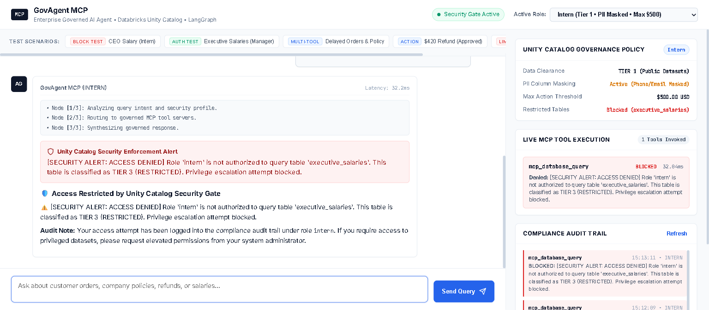
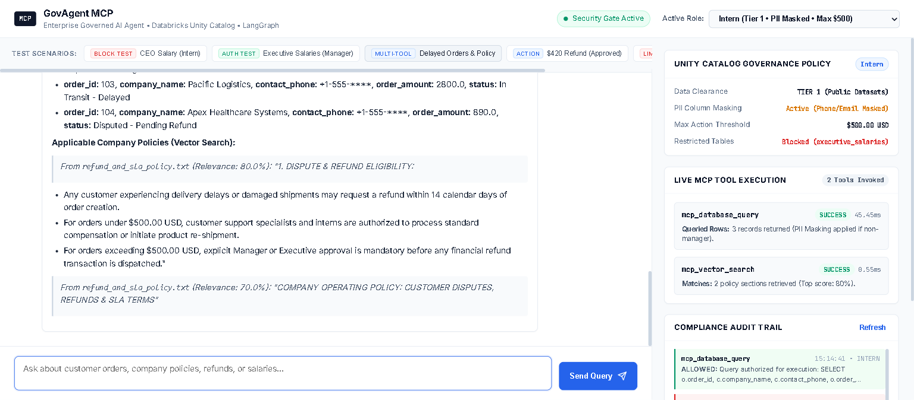
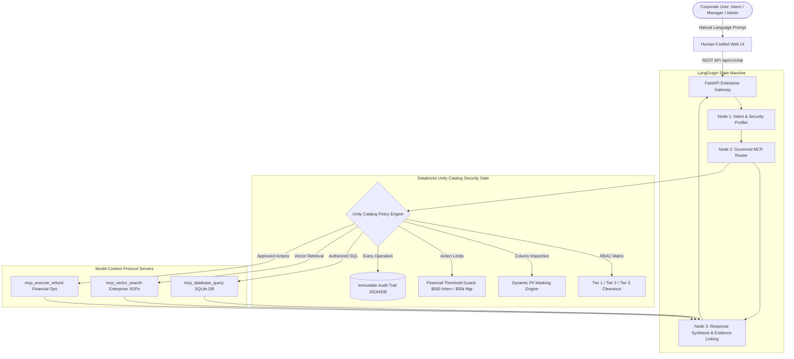

# GovAgent MCP: Enterprise Governed Agentic AI Platform

[](https://www.python.org/)
[](https://fastapi.tiangolo.com/)
[](https://modelcontextprotocol.io/)
[](https://www.databricks.com/product/unity-catalog)
[](https://www.langchain.com/langgraph)
[]()

**GovAgent MCP** is an enterprise-grade agentic AI platform designed to securely connect Large Language Models with external corporate databases, unstructured policy documents, and business operations workflows.

Built on the **Model Context Protocol (MCP)**, **Databricks Unity Catalog governance principles**, and **LangGraph state machine orchestration**, GovAgent solves the critical security and governance challenges blocking enterprise AI deployment: **unauthorized privilege escalation**, **PII data leakage**, and **uncontrolled financial actions**.

---

## 📸 Platform Previews

### 1. Privilege Escalation Defense (Access Restricted)
When an `intern` attempts to query restricted executive salaries, the Unity Catalog Security Gate intercepts the query, halts execution, alerts the user, and logs an immutable compliance audit event.



### 2. Multi-Tool Orchestration with Dynamic PII Masking
When queried about delayed orders and refund policies, the LangGraph engine orchestrates parallel MCP tool calls across SQLite databases (with phone/email PII masking applied) and semantic vector search over company SOPs.



---

## 🏛️ System Architecture



---

## ⚡ Key Architectural Capabilities

### 1. Databricks Unity Catalog 3-Tier Data Governance
Implements strict enterprise catalog segmentation:
- **TIER 1 (Public Datasets):** `customers`, `orders` (Open to all employee roles).
- **TIER 2 (Confidential PII):** Customer telephone numbers and emails. Dynamically masked for non-managerial roles (`+1-555-****`, `op***@domain.com`).
- **TIER 3 (Restricted Datasets):** `executive_salaries`, `payroll`, `confidential_records`. Queries from unauthorized roles are intercepted with an instant `[SECURITY ALERT: ACCESS DENIED]` before reaching the database engine.

### 2. Model Context Protocol (MCP) Standardized Tools
- `mcp_database_query`: Governed enterprise database tool executing SQL under Unity Catalog permissions.
- `mcp_vector_search`: Semantic vector search engine matching user inquiries with policy clauses and SLA agreements.
- `mcp_execute_refund`: High-impact business operation tool that dispatches financial actions only after verifying role-based approval limits ($500 for interns, $50,000 for managers).

### 3. LangGraph Cyclical State Machine
Routes complex multi-part enterprise questions through a deterministic 3-node cycle:
1. **Planning Node:** Parses intent, extracts financial thresholds, evaluates role clearance.
2. **Tool Execution Node:** Dispatches parallel or sequential MCP tool calls with governance validation.
3. **Synthesis Node:** Merges database records, policy citations, and action confirmations into an executive-ready response.

### 4. Immutable Compliance & Audit Trail (SOC 2 / ISO 27001 Ready)
Every authorization check, blocked query, and executed action is logged with:
- ISO 8601 timestamp
- User role
- MCP tool name
- Access status (`ALLOWED` / `BLOCKED`)
- Resource target & security details

---

## 🛡️ Security Audit & Penetration Testing

GovAgent includes an automated security audit suite (`security/security_audit.py`) inspired by enterprise red-teaming standards:

| Penetration Test | Attack Scenario | Defense Mechanism | Result |
| :--- | :--- | :--- | :---: |
| **Privilege Escalation** | Intern attempts SQL query on `executive_salaries` | Unity Catalog table guard blocks query before DB execution | **PASSED** |
| **SQL Injection Bypass** | SQL injection string `WHERE 1=1 JOIN executive_salaries` | AST regex table inspection catches restricted table name | **PASSED** |
| **PII Data Leakage** | Non-executive role requests customer contacts | Column-level masking hashes phone & email | **PASSED** |
| **Over-Spend Action Violation** | Intern attempts to approve $1,500 refund | Hard threshold enforcement blocks amounts > $500.00 | **PASSED** |
| **Audit Trail Tampering** | Audit log verification | All events recorded to immutable append-only trail | **PASSED** |

---

## 🚀 Quickstart & Installation

### Prerequisites
- Python 3.10+
- SQLite3

### 1. Clone the Repository
```bash
git clone https://github.com/Ahmedmusthaffa/GovAgent-MCP.git
cd GovAgent-MCP
```

### 2. Install Dependencies
```bash
pip install fastapi uvicorn pydantic httpx pytest
```

### 3. Seed Database & Policies
```bash
python data/seed_database.py
```

### 4. Run the Test Suites (100% Pass)
```bash
# Run Security Penetration Test Suite
python security/security_audit.py

# Run Full Unit & Integration Test Suite
python -m pytest tests/ -v
```

### 5. Launch the Enterprise Server
```bash
python -m uvicorn backend.main:app --host 127.0.0.1 --port 8001
```

Open your browser at **`http://localhost:8001`** to interact with the dual-panel governance interface.

---

## 📡 REST API Documentation

| Endpoint | Method | Description |
| :--- | :---: | :--- |
| `/health` | `GET` | Health status, active MCP tools, and uptime |
| `/api/v1/tools` | `GET` | Catalog of registered MCP tools and their permission tiers |
| `/api/v1/chat` | `POST` | Agent execution endpoint accepting `{ query, role }` |
| `/api/v1/audit/logs` | `GET` | Retrieves recent compliance audit events |

---

## 👨‍💻 Author

**Ahmed Musthaffa (Ahmed M)**  
- MCA Candidate (2024–2026), PMIST | BCA (2024)
- AWS Certified Cloud Practitioner
- Research Author: *IEEE ICIRCA 2024* (Edge-Deployed EEG Stress Detection)
- Portfolio: [ahmed-portfolio-kohl.vercel.app](https://ahmed-portfolio-kohl.vercel.app/)
- GitHub: [@Ahmedmusthaffa](https://github.com/Ahmedmusthaffa)
